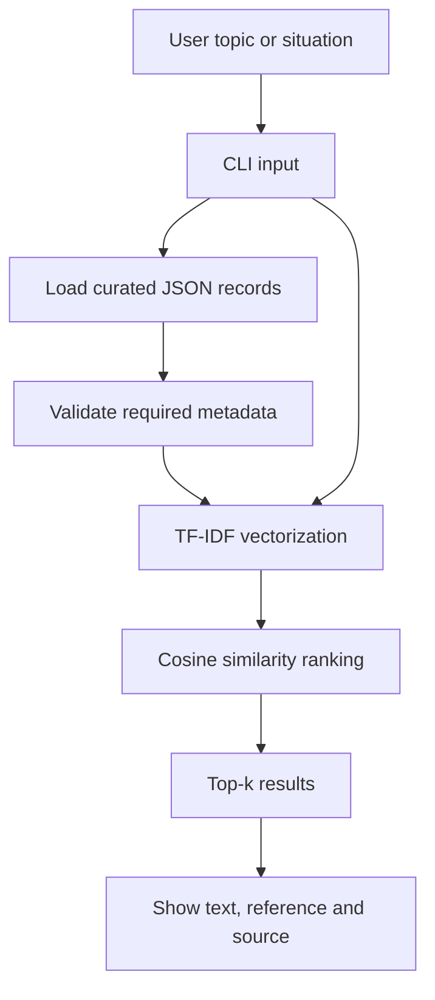

# System architecture

The current implementation is a local retrieval baseline. It does not call an LLM, generate commentary, authenticate narrations, or infer religious rulings. A future architecture may add multilingual embeddings and human-reviewed explanations, but source-grounded retrieval should remain independently testable.
